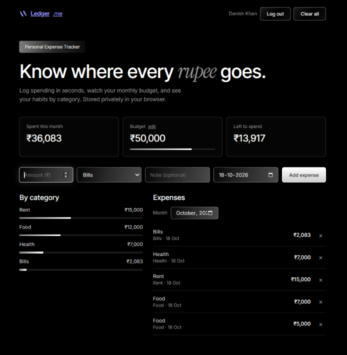

# Ledger — Personal Expense Tracker

A full-stack expense tracker where every person signs in with Google and gets their own private ledger. Log spending, set a monthly budget, and see where your money goes by category.

**Live demo:** https://expense-tracker-wfbh.onrender.com
*(Hosted on a free plan, so the first visit after a quiet period can take up to a minute to wake up.)*

<!-- Add a screenshot: save it as docs/screenshot.png, then replace this line with:  -->

## Features
- **Sign in with Google**: no passwords to manage; each account gets a separate ledger
- **Add and delete expenses** with amount, category, note and date
- **Monthly view** with total spent, budget progress bar and amount left
- **Spending by category** breakdown for any month
- **Per-user budget** you can edit any time
- **CSV export** of your expenses through the API
- Data is stored in a cloud database, so it persists across devices and restarts

## Tech stack
| Layer | Tools |
|---|---|
| Frontend | HTML, CSS and vanilla JavaScript, with the Google Identity Services button |
| Backend | Node.js, Express |
| Database | Turso (libSQL / SQLite in the cloud) |
| Auth | Google OAuth 2.0 ID tokens, verified server-side |
| Hosting | Render (backend and static frontend), GitHub for source |

## How it works
1. The page loads the Google sign-in button using the app's client ID.
2. Google returns a signed ID token; the server verifies the signature, audience, expiry and that the email is verified.
3. The server issues its own session token (stored hashed, expires after 30 days).
4. Every API query is scoped to the signed-in user's ID, so users can't read or change each other's data. Automated tests cover this.

## Security notes
- Google tokens are verified on the server, never trusted from the browser
- Session tokens are stored as SHA-256 hashes; sessions expire and end on logout
- Login attempts are rate limited per IP
- Amounts are stored as integer paise to avoid floating-point rounding errors
- Secrets live in environment variables, not in the code
- Limitation: it is not end-to-end encrypted, so the database owner can technically read the data

## API
All routes except `/api/health`, `/api/config` and `/api/auth/google` need `Authorization: Bearer <token>`.

| Method | Path | Purpose |
|---|---|---|
| POST | `/api/auth/google` | Exchange a Google credential for a session token |
| GET | `/api/me` | Current user |
| POST | `/api/logout` | End the session |
| GET | `/api/expenses?month=YYYY-MM` | List a month's expenses |
| POST | `/api/expenses` | Add an expense |
| DELETE | `/api/expenses/:id` | Delete one expense |
| DELETE | `/api/expenses` | Delete all of your expenses |
| GET, PUT | `/api/budget` | Read or set your monthly budget |
| GET | `/api/summary?month=YYYY-MM` | Total, budget, amount left and per-category totals |
| GET | `/api/export.csv` | Download your expenses |

## Run it locally
Requires Node.js 22 or newer.

```bash
git clone https://github.com/dkhan075/EXPENSE-TRACKER.git
cd EXPENSE-TRACKER
npm install
```

Create an OAuth **Web application** client in Google Cloud (Google Auth Platform → Clients) and add `http://localhost:3000` under *Authorised JavaScript origins*. Then start the app:

```bash
# macOS / Linux
GOOGLE_CLIENT_ID=your-client-id npm start

# Windows PowerShell
$env:GOOGLE_CLIENT_ID="your-client-id"; npm start
```

Open http://localhost:3000. Without Turso variables it saves to a local `ledger.db` file.

Run the API tests with `npm test`.

## Environment variables
| Variable | Required | Purpose |
|---|---|---|
| `GOOGLE_CLIENT_ID` | Yes | OAuth Web client ID from Google Cloud |
| `TURSO_DATABASE_URL`, `TURSO_AUTH_TOKEN` | For cloud hosting | Turso database connection |
| `OWNER_EMAIL` | Recommended | Gmail that adopts any expenses saved before Google login existed |
| `ALLOWED_EMAILS` | Optional | Comma-separated Gmail list; if set, only these (plus the owner) can sign in |
| `DB_PATH` | Optional | Local database file path when not using Turso |
| `PORT` | Optional | Server port (default 3000) |

## Ideas for next steps
Editing expenses, recurring expenses, income tracking, multi-month charts, and a CSV download button in the UI.
